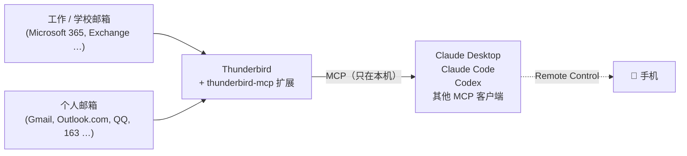
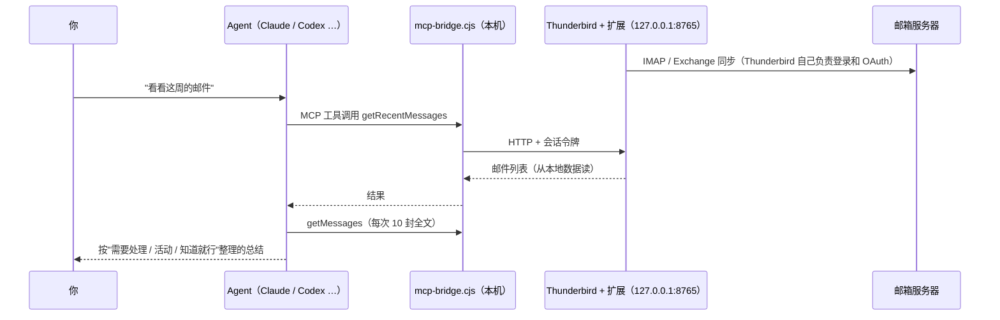

# 📬 Thunderbird Mail Agent

**中文** | [English](README_EN.md)

**用一个免费的邮件客户端，把你所有邮箱交给 AI Agent 管理。**

## 适合这些情况

1. **想把工作邮箱和个人邮箱放在一起管**：AI 平台的邮件连接器通常一个邮箱一个，彼此独立。这里所有邮箱都在一个 Thunderbird 里，Agent 一次就能全部看到。
2. **工作邮箱不方便直接接 MCP**：很多学校和公司的 Microsoft 365 / Google Workspace 不允许员工自行授权第三方应用，个人版 AI 账号也连不上机构邮箱。只要你的机构允许用 Thunderbird 这类邮件客户端登录（很多机构都允许，可以先试试），这套方案就能用，**不需要找 IT 批准新的应用**。
3. **想让 AI 定期帮你过一遍邮件**：每封都读全文，整理出待办、截止日期和近期活动，回复只存草稿，由你确认后再发。

## 一眼看懂

Thunderbird 负责登录你的各个邮箱：工作邮箱、学校邮箱、Gmail、Outlook、QQ、163 都行。[thunderbird-mcp](https://github.com/TKasperczyk/thunderbird-mcp) 再把它们以 MCP 工具的形式交给 Claude、Codex 或任何支持 MCP 的 Agent。之后你只要说一句"看看这周的邮件"，Agent 就会把每个邮箱的每一封邮件读完，整理出要处理的事、截止日期和近期活动，需要时还会帮你起草回复，存成草稿等你确认后再发。



| | |
|---|---|
| **它做什么** | 让 AI Agent 读取、总结、搜索你所有邮箱里的邮件，跟踪待办和活动，起草回复 |
| **花多少钱** | **完全免费**。Thunderbird、扩展和本仓库都是开源的，用你已有的 Agent 即可 |
| **支持哪些邮箱** | **Thunderbird 能登录的都支持**：Microsoft 365 / Exchange、Gmail、Outlook.com、iCloud、QQ、163、企业邮箱等 |
| **支持哪些 Agent** | **所有支持 MCP 的 Agent**：Claude Desktop、Claude Code、Codex、Cursor、VS Code 等，手机上可以通过 Claude 的 Remote Control 使用 |
| **数据去哪了** | 邮件存在你自己电脑上的 Thunderbird 里。只有 Agent 读取某封邮件时，那封邮件的内容才会发给你所用的 AI 服务 |
| **主要缺点** | **Thunderbird 必须一直开着**（电脑也要开着）。有条件的话，可以把它放在一台常开的电脑或服务器上，见[常开部署](docs/server.md) |

### 和其他方案比

| 方案 | 费用 | 多邮箱 | 机构邮箱 | 自选 Agent | 需要常开电脑 |
|---|---|---|---|---|---|
| **本方案** | 免费 | ✅ 任意数量 | ✅ 允许 Thunderbird 就行 | ✅ 任何 MCP Agent | ⚠️ 需要 |
| AI 平台自带的邮件连接器 | 含在订阅里 | 一般各连各的 | ❌ 常常需要管理员批准 | ❌ 只能用该平台 | 不需要 |
| 付费邮件 AI 服务（自带 MCP） | 约 $20–40/月 | ✅ | ⚠️ 同样可能需要批准 | 部分支持 | 不需要 |
| 自己写 IMAP 脚本或 MCP | 免费 | ✅ | ⚠️ OAuth 要自己处理 | ✅ | 看部署方式 |

---

## 功能

### 1. 邮件总结（质量优先）
- **逐封读全文**：不按发件人或标题跳过。银行通知会检查有没有异常交易，newsletter 和群通知里藏的截止日期也不会漏。
- **数量自查**：读过的封数必须等于收件箱里的总数，总结第一行写明"共 N 封，已全部读完"。
- **邮件多时并行读**：Agent 支持子代理时，每 10 封分给一个子代理去读，每封都要交回一份要点。
- **结构固定，方便在手机上看**：需要处理 → 近期活动 → 知道就行 → 可忽略（只给数量）。

### 2. 活动追踪
- 每次额外回看最近 **30 天**里所有和活动有关的邮件，因为活动通知经常提前几周发。
- 每个活动列 12 项信息：名称、日期星期、起止时间、地点（是否需要 VPN）、主讲人或主办方、内容、是否要报名、报名截止和方式、是否有餐食、面向谁、是不是日历邀请以及你是否已回复、是否每周重复。邮件里没写的标"未说明"，不会猜。
- 未来 7 天内的标 **本周**，3 天内截止报名的标 **尽快报名**。同一活动的多封邮件合并成一条，改期、改地点、取消会明确指出。
- 维护一份 `upcoming-events.md`，下次总结时对比，告诉你哪些是新增的、哪些有变化。

### 3. 待办和截止日期
按截止时间排序，写清要做什么、出处（哪个邮箱、谁发的）。日期统一换算成具体日期和星期几。

### 4. 起草回复（默认存草稿）
Agent 先在对话里给你看回复全文，你确认后才**存进邮箱的草稿箱**。草稿会同步到服务器，你在手机的邮件 App 里检查后自己发送。Agent 不会替你直接发信。

### 5. 搜索和查询
"导师上个月说的截止日期是哪天？""找一下带附件的签证材料邮件"：可以按发件人、标题、时间、正文搜索。

### 6. 手机上用
借助 Claude 的 Remote Control，在手机上发起的会话会在你的电脑上运行，所以能用上 Thunderbird。见[手机使用](docs/mobile.md)。

### 7. 默认偏安全
| 设置 | 默认 |
|---|---|
| 发信、回复、转发、建日程 | 必须弹窗确认（扩展的 *Block skipReview* 开启）；Agent 的规则里还要求只存草稿 |
| 删除邮件、清空废件箱等 | 建议在扩展里直接关掉这些工具 |
| 邮件里的链接 | Agent 不点击，只列给你 |
| 邮件里的"指令" | 当作不可信数据，不执行（防提示注入） |
| 扩展自动更新 | 建议关闭，锁定在审查过的版本（见[安全说明](docs/security.md)） |
| 本地服务 | 只监听本机 127.0.0.1，需要令牌才能访问 |

## 自动盯邮箱：监控 Agent（`monitor/`）

上面的功能都要你开口问。`monitor/` 是一个可以定时跑的 Python 程序，让 Agent 自己盯着：每 5 分钟巡检所有收件箱，新邮件进来就判断"谁、什么事、要不要管、几号前"，要管的即时推到飞书 / Lark，其余攒成早晚汇总。规则先过滤（验证码不推、订阅只汇总、导师一律紧急），模型再判断（固定结构的 JSON，经过校验），SQLite 记住处理过的邮件、每个发件人是谁、同一话题之前说了什么。它只读邮件，不发不删。安装、配置、接飞书和评测方法见 [monitor/README.md](monitor/README.md)。

---

## 快速开始

> 下面以 macOS 为例，Windows 和 Linux 的区别写在各步骤里。总共大约 15 分钟。

### 第 1 步：安装 Thunderbird，登录邮箱
从 [thunderbird.net](https://www.thunderbird.net) 下载安装，然后逐个添加邮箱。大部分邮箱会自动识别。Microsoft 365 工作或学校邮箱如果要求手动填写，按下表：

| | 服务器 | 端口 | 加密 | 认证方式 |
|---|---|---|---|---|
| 收件 IMAP | `outlook.office365.com` | 993 | SSL/TLS | **OAuth2** |
| 发件 SMTP | `smtp.office365.com` | 587 | STARTTLS | **OAuth2** |

- 一定要选 **OAuth2**。微软已经不接受用密码登录 IMAP。
- QQ、163 等邮箱需要先在网页版设置里开启 IMAP 并生成**授权码**，用授权码代替密码。
- 加完后在账户上点右键 → **订阅**，勾选"草稿 / 已发送 / 垃圾邮件 / 存档"。机构邮箱默认可能只显示收件箱，不订阅的话存不了草稿。

更多细节（包括界面怎么调得更清楚）见 [docs/thunderbird.md](docs/thunderbird.md)。

### 第 2 步：安装 Node.js
到 [nodejs.org](https://nodejs.org) 下载 **LTS 版安装包**（macOS 用 `.pkg`）。建议用安装包而不是 nvm，因为路径固定，图形界面的 Agent 也能找到它。

```bash
node -v   # 能显示版本号就说明装好了
```

### 第 3 步：安装 thunderbird-mcp 扩展（锁定版本）

```bash
git clone https://github.com/yuhang2551/thunderbird-mail-agent.git ~/thunderbird-mail-agent
cd ~/thunderbird-mail-agent
./scripts/install-thunderbird-mcp.sh      # 下载 v0.9.2 到 ~/thunderbird-mcp 并校验 SHA-256
```

然后在 Thunderbird 里：**工具 → 附加组件和主题 → 齿轮图标 → 从文件安装附加组件**，选择 `~/thunderbird-mcp/dist/thunderbird-mcp.xpi`，装好后重启一次 Thunderbird。

> 安装时会提示它"拥有对 Thunderbird 和电脑的完全访问权限"。这是因为扩展用了 Thunderbird 的 Experiment API 来开本地服务，具体说明和我们对代码的检查结果见 [docs/security.md](docs/security.md)。

**装好后建议这样设置**（扩展页面 → Thunderbird MCP → 首选项 / 详细信息）：
- ✅ 保持 **Block skipReview** 开启
- ✅ 保持 **Listen on all interfaces** 关闭
- ✅ 在 Tool Access 里取消勾选 `deleteMessages`、`deleteFolder`、`emptyTrash`、`emptyJunk`、`deleteContact`、`deleteEvent`、`deleteFilter`
- ✅ 在"详细信息"里把 **允许自动更新** 设为 **关**

### 第 4 步：接入你的 Agent

| Agent | 命令 |
|---|---|
| Claude Desktop | `./scripts/setup-claude-desktop.sh`，然后彻底退出并重开 Claude |
| Claude Code | `./scripts/setup-claude-code.sh` |
| Codex（CLI / IDE） | `./scripts/setup-codex.sh` |
| 其他 MCP 客户端 | 命令 `node`，参数 `~/thunderbird-mcp/mcp-bridge.cjs`（stdio），见 [docs/agents.md](docs/agents.md) |

脚本都会**先备份**原配置再写入，可以重复运行。之后可以运行 `./scripts/doctor.sh` 自检：它会检查能不能连上 Thunderbird、删除类工具有没有关掉。

### 第 5 步：装上"邮件助手规则"
Agent 拿到工具以后，还需要知道**怎么**处理邮件：每封都读全文、活动要详细、只存草稿、不点链接等。本仓库提供两种形式：

- **Claude（聊天）**：把 [`templates/skill/SKILL.md`](templates/skill/SKILL.md) 作为技能（Skill）添加到 Claude。
- **Claude Code / Codex / 手机端**：运行下面的命令，生成一个专用的工作文件夹。里面有 `CLAUDE.md` / `AGENTS.md`（规则）、`.mcp.json`（连接方式）、`.claude/settings.json`（只读工具免确认）和 `upcoming-events.md`（活动清单）。

```bash
./scripts/create-mail-workspace.sh        # 默认生成 ~/mail-workspace
```

打开 `~/mail-workspace/CLAUDE.md`，在"我的邮箱"一节填上你的邮箱和偏好，比如回复用什么语言、署名写什么。

### 第 6 步：试一下

```
看看这周的邮件
接下来两周学校有什么活动？哪些要报名？
导师最近有没有发邮件要我做什么？
帮我回复 xxx 那封邮件，说周四下午可以，存成草稿
```

---

## 工作原理



1. **登录交给 Thunderbird。** 各邮箱的 OAuth、授权码、令牌刷新都由 Thunderbird 处理。这也是机构邮箱能用的原因：对学校或公司来说，你只是在用一个常见的邮件客户端。
2. **扩展在 Thunderbird 里开一个本地服务**（只监听 127.0.0.1，需要令牌）。它把邮件、文件夹、联系人、日历、过滤器等以 40 个工具的形式提供出来。
3. **`mcp-bridge.cjs` 做转接**：Agent 通过 stdio 启动它，它把 MCP 请求转发给本地服务。它只用 Node 自带的模块，没有第三方依赖。
4. **规则文件决定 Agent 的行为**：SKILL.md、CLAUDE.md、AGENTS.md 规定了读邮件的流程、输出格式和安全边界，所以换一个 Agent 也能得到一致的结果。

### 已验证的组合

| 组合 | 状态 |
|---|---|
| macOS + Thunderbird + Microsoft 365（学校，IMAP OAuth2）+ Gmail（IMAP） | ✅ 作者实测 |
| Claude Desktop（本地 MCP） | ✅ 作者实测 |
| Claude Code Remote Control（手机发起，在 Mac 上运行） | ⚙️ 已配置 |
| Codex CLI / IDE | ⚙️ 按 thunderbird-mcp 官方说明配置，欢迎反馈 |
| Windows / Linux | ⚙️ 扩展官方支持；本仓库脚本支持 Linux，Windows 按文档手动配置 |

---

## 仓库里有什么

| 路径 | 内容 |
|---|---|
| `scripts/` | 安装扩展（锁定版本并校验）、接入各 Agent、生成邮件工作文件夹、自检 `doctor.sh` |
| `monitor/` | 邮箱监控 Agent：定时巡检、判断、推送到飞书 / Lark 的 Python 程序，见 [monitor/README.md](monitor/README.md) |
| `templates/mail-workspace/` | 邮件工作文件夹的规则 `CLAUDE.md` 和活动清单 `upcoming-events.md` |
| `templates/skill/` | 给 Claude 用的技能 `SKILL.md`（和上面的规则内容一致） |
| `docs/` | 详细文档，见下表 |

## 文档

| 文档 | 内容 |
|---|---|
| [docs/thunderbird.md](docs/thunderbird.md) | 各类邮箱怎么登录、订阅文件夹、把界面调得更清楚 |
| [docs/agents.md](docs/agents.md) | 各种 Agent 的手动配置方法 |
| [docs/mobile.md](docs/mobile.md) | 在手机上用（Claude Remote Control） |
| [docs/server.md](docs/server.md) | 常开部署：避开"电脑必须开着"的限制 |
| [docs/security.md](docs/security.md) | 权限说明、代码检查结果、更新流程、提示注入防护 |
| [docs/troubleshooting.md](docs/troubleshooting.md) | 常见问题 |

## 常见问题（简版）

**为什么不直接用 AI 平台自带的 Gmail / Outlook 连接器？** 能用的话，那样更省事。但它们通常一个邮箱一个，而且机构邮箱常常需要管理员批准；个人 AI 账号经常连不上工作邮箱。这个项目主要解决这两种情况。

**Agent 会乱发邮件吗？** 默认不会。扩展层面发信必须弹窗确认，规则层面要求只存草稿，删除类工具也建议关掉。

**我的邮件会被上传吗？** 邮件存在你本机的 Thunderbird 里。只有 Agent 读取某封邮件时，那封邮件的内容才会发给你所用的 AI 服务，规则和你直接把邮件粘贴给 AI 是一样的。

**Thunderbird 的界面不好用？** 你不需要看它，让它在后台开着就行，平时继续用你喜欢的邮件 App。想用它看邮件的话，见 [docs/thunderbird.md](docs/thunderbird.md#界面优化) 里的调整建议。

## 致谢

- [TKasperczyk/thunderbird-mcp](https://github.com/TKasperczyk/thunderbird-mcp)（MIT）：Thunderbird 扩展和 MCP 转接程序，本方案的核心。本仓库**不包含**它的代码，只提供锁定版本的安装脚本。
- [Mozilla Thunderbird](https://www.thunderbird.net)

## 许可证

[MIT](LICENSE)
