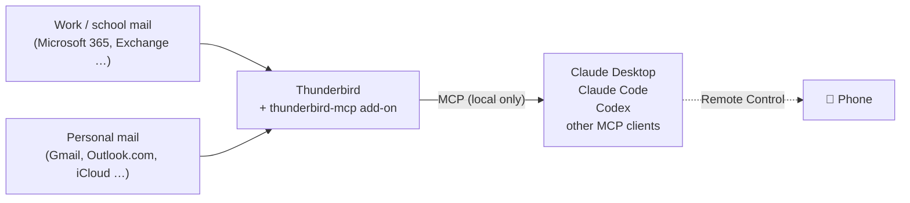
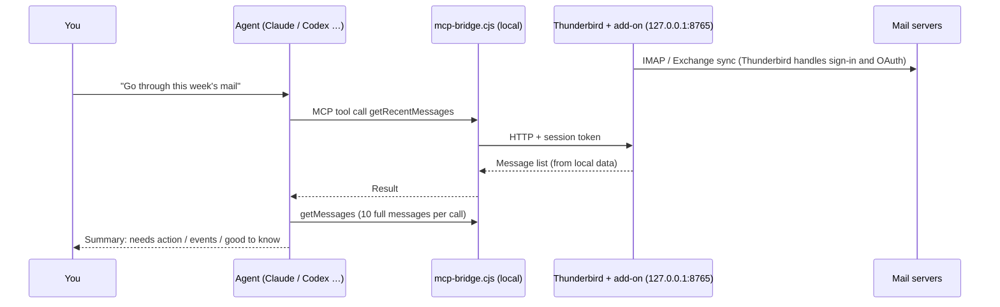

# 📬 Thunderbird Mail Agent

[中文](README.md) | **English**

**Use a free mail client to hand all your mailboxes to an AI agent.**

## When this is useful

1. **You want work and personal mail in one place.** AI platforms' mail connectors usually connect one mailbox at a time, each on its own. Here every mailbox lives in one Thunderbird, so the agent sees all of them at once.
2. **Your work mailbox can't be connected to MCP directly.** Many schools and companies don't let staff authorize third-party apps on Microsoft 365 / Google Workspace, and personal AI accounts often can't reach institutional mailboxes. If your institution lets you sign in with a mail client like Thunderbird (many do, so try it), this setup works **without asking IT to approve a new app**.
3. **You want an AI to go through your mail regularly.** It reads every message in full, pulls out to-dos, deadlines and upcoming events, and saves replies as drafts that you review and send yourself.

## At a glance

Thunderbird signs in to your mailboxes: work, school, Gmail, Outlook, iCloud, QQ, 163 and so on. [thunderbird-mcp](https://github.com/TKasperczyk/thunderbird-mcp) then exposes them as MCP tools to Claude, Codex or any MCP-capable agent. Say "go through this week's mail" and the agent reads every message in every mailbox, lists what needs action, deadlines and upcoming events, and drafts replies when you ask. Drafts are saved for you to review before sending.



| | |
|---|---|
| **What it does** | Lets an AI agent read, summarize and search mail across all your mailboxes, track to-dos and events, and draft replies |
| **Cost** | **Free.** Thunderbird, the add-on and this repo are open source; use the agent you already have |
| **Mailboxes** | **Anything Thunderbird can sign in to**: Microsoft 365 / Exchange, Gmail, Outlook.com, iCloud, QQ, 163, company mail servers |
| **Agents** | **Any MCP-capable agent**: Claude Desktop, Claude Code, Codex, Cursor, VS Code and others; on your phone through Claude's Remote Control |
| **Where your data goes** | Mail stays in Thunderbird on your computer. A message's content is sent to your AI provider only when the agent reads that message |
| **Main drawback** | **Thunderbird has to keep running** (so does the computer). You can move it to an always-on machine or server, see [always-on setup](docs/server.md) |

### Compared with other options

| Option | Cost | Multiple mailboxes | Institutional mail | Choose your agent | Needs an always-on computer |
|---|---|---|---|---|---|
| **This project** | Free | ✅ any number | ✅ if Thunderbird is allowed | ✅ any MCP agent | ⚠️ yes |
| Built-in mail connectors of AI platforms | Included in subscription | Usually one by one | ❌ often needs admin approval | ❌ that platform only | No |
| Paid AI email services (with MCP) | about $20–40/month | ✅ | ⚠️ may also need approval | Some | No |
| Your own IMAP script or MCP server | Free | ✅ | ⚠️ you handle OAuth | ✅ | Depends |

---

## Features

### 1. Mail summaries (quality first)
- **Reads every message in full.** Nothing is skipped by sender or subject. Bank notices are checked for unusual transactions; deadlines hidden in newsletters and group notifications are caught.
- **Count check.** The number of messages read must equal the number in the inbox; the first line of the summary says "N messages, all read".
- **Parallel reading for large batches.** If the agent supports subagents, every 10 messages go to one subagent, which must return notes for each message.
- **Fixed layout that reads well on a phone**: needs action → upcoming events → good to know → can ignore (counts only).

### 2. Event tracking
- Each run also looks back **30 days** for event-related mail, because event announcements often go out weeks ahead.
- Each event gets 12 fields: name, date and weekday, start and end time, location (and whether a VPN is needed), speaker or organizer, topic, whether registration is required, registration deadline and method, food, audience, whether it is a calendar invite and whether you replied, and whether it repeats weekly. Missing fields are marked "not stated" rather than guessed.
- Events in the next 7 days are marked **this week**; registration closing within 3 days is marked **register soon**. Multiple emails about one event are merged, and reschedules, room changes and cancellations are called out.
- An `upcoming-events.md` file is kept up to date, so the next run can tell you what is new or changed.

### 3. To-dos and deadlines
Sorted by deadline, each with what to do and where it came from (which mailbox, who sent it). Dates are converted to exact dates with weekdays.

### 4. Reply drafts (saved as drafts by default)
The agent shows you the full reply in the conversation first, and only after you approve does it **save it to the mailbox's Drafts folder**. Drafts sync to the server, so you can review and send them from your phone's mail app. The agent does not send mail for you.

### 5. Search
"What deadline did my advisor mention last month?" "Find the visa email with attachments." Search by sender, subject, date range or body text.

### 6. On your phone
With Claude's Remote Control, a session you start on your phone runs on your computer, so it can use Thunderbird. See [mobile use](docs/mobile.md).

### 7. Safe defaults
| Setting | Default |
|---|---|
| Sending, replying, forwarding, creating events | Must be confirmed in a pop-up (the add-on's *Block skipReview* is on); the rules also tell the agent to save drafts only |
| Deleting mail, emptying trash, etc. | Turn these tools off in the add-on (recommended) |
| Links in mail | The agent doesn't open them, it lists them for you |
| "Instructions" inside mail | Treated as untrusted data and never followed (prompt-injection defense) |
| Add-on auto-update | Turn it off and stay on the reviewed version (see [security](docs/security.md)) |
| Local server | Listens on 127.0.0.1 only and requires a token |

## Hands-off monitoring: the mail-monitor agent (`monitor/`)

Everything above waits for you to ask. `monitor/` is a Python program that runs on a schedule and watches for you: every 5 minutes it checks every inbox, and for each new message it decides who it is from, what it wants, whether you need to act and by when. Mail that needs you is pushed to Feishu / Lark right away; the rest is batched into a morning and an evening digest. Rules go first (verification codes are never pushed, newsletters only in digests, your advisor is always urgent), then an LLM judges the rest with a fixed JSON schema that is validated before use. SQLite remembers which mail was handled, who each sender is and what the same thread said earlier. It only reads mail and never sends or deletes. Setup, configuration, the Lark push and the evaluation loop are in [monitor/README_EN.md](monitor/README_EN.md).

---

## Quick start

> The steps use macOS as the example; Windows and Linux differences are noted where they matter. About 15 minutes in total.
>
> The detailed docs under `docs/` and the rule templates under `templates/` are written in Chinese. The templates tell the agent to answer in Chinese: change the line `输出用中文` ("answer in Chinese") to your language, or ask your agent to translate the template for you.

### Step 1: Install Thunderbird and add your mailboxes
Download it from [thunderbird.net](https://www.thunderbird.net) and add each mailbox. Most are detected automatically. If a Microsoft 365 work or school account needs manual settings:

| | Server | Port | Security | Authentication |
|---|---|---|---|---|
| Incoming IMAP | `outlook.office365.com` | 993 | SSL/TLS | **OAuth2** |
| Outgoing SMTP | `smtp.office365.com` | 587 | STARTTLS | **OAuth2** |

- Choose **OAuth2**. Microsoft no longer accepts passwords for IMAP.
- For iCloud, use an app-specific password. For QQ, 163 and similar, enable IMAP in the web settings and use the generated authorization code as the password.
- Afterwards, right-click the account → **Subscribe** and tick Drafts, Sent, Junk and Archive. Institutional accounts may only show the inbox at first, and without Drafts the agent can't save drafts.

### Step 2: Install Node.js
Download the **LTS installer** from [nodejs.org](https://nodejs.org) (`.pkg` on macOS). The installer is better than nvm here: its path doesn't change, so GUI agents can always find it.

```bash
node -v   # prints a version number if it worked
```

### Step 3: Install the thunderbird-mcp add-on (pinned version)

```bash
git clone https://github.com/yuhang2551/thunderbird-mail-agent.git ~/thunderbird-mail-agent
cd ~/thunderbird-mail-agent
./scripts/install-thunderbird-mcp.sh      # downloads v0.9.2 to ~/thunderbird-mcp and verifies its SHA-256
```

Then in Thunderbird: **Tools → Add-ons and Themes → gear icon → Install Add-on From File**, choose `~/thunderbird-mcp/dist/thunderbird-mcp.xpi`, and restart Thunderbird once.

> The install prompt says the add-on has full access to Thunderbird and your computer. That's because it uses Thunderbird's Experiment API to run a local server. See [docs/security.md](docs/security.md) for the explanation and what we checked in the code.

**Recommended settings** (Add-ons page → Thunderbird MCP → Preferences / Details):
- ✅ Keep **Block skipReview** on
- ✅ Keep **Listen on all interfaces** off
- ✅ Under Tool Access, untick `deleteMessages`, `deleteFolder`, `emptyTrash`, `emptyJunk`, `deleteContact`, `deleteEvent`, `deleteFilter`
- ✅ Under Details, set **Allow automatic updates** to **Off**

### Step 4: Connect your agent

| Agent | Command |
|---|---|
| Claude Desktop | `./scripts/setup-claude-desktop.sh`, then fully quit and reopen Claude |
| Claude Code | `./scripts/setup-claude-code.sh` |
| Codex (CLI / IDE) | `./scripts/setup-codex.sh` |
| Other MCP clients | command `node`, argument `~/thunderbird-mcp/mcp-bridge.cjs` (stdio); see [docs/agents.md](docs/agents.md) |

Each script **backs up** the existing config before writing and is safe to run again. Then run `./scripts/doctor.sh` to check that Thunderbird is reachable and the delete tools are off.

### Step 5: Add the mail rules
Once the agent has the tools, it also needs to know **how** to handle mail: read everything in full, track events in detail, save drafts only, never open links. Two forms are provided:

- **Claude (chat)**: add [`templates/skill/SKILL.md`](templates/skill/SKILL.md) to Claude as a skill.
- **Claude Code / Codex / phone**: run the command below to create a dedicated folder with `CLAUDE.md` / `AGENTS.md` (rules), `.mcp.json` (connection), `.claude/settings.json` (read-only tools need no confirmation) and `upcoming-events.md` (event list).

```bash
./scripts/create-mail-workspace.sh        # creates ~/mail-workspace by default
```

Open `~/mail-workspace/CLAUDE.md` and fill in the "我的邮箱" ("my mailboxes") section: your addresses, reply language, signature and time zone.

### Step 6: Try it

```
Go through this week's mail
What events are coming up in the next two weeks? Which need registration?
Has my advisor asked me to do anything recently?
Reply to the email from xxx saying Thursday afternoon works, and save it as a draft
```

---

## How it works



1. **Thunderbird handles sign-in.** OAuth, authorization codes and token refresh for every mailbox are Thunderbird's job. This is also why institutional mail works: to your school or company, you're just using a common mail client.
2. **The add-on runs a local server inside Thunderbird** (127.0.0.1 only, token required). It exposes mail, folders, contacts, calendars and filters as 40 tools.
3. **`mcp-bridge.cjs` connects the two.** The agent starts it over stdio and it forwards MCP requests to the local server. It uses only Node's built-in modules, no third-party dependencies.
4. **Rule files decide how the agent behaves.** SKILL.md, CLAUDE.md and AGENTS.md define the reading process, output format and safety limits, so switching agents gives consistent results.

### Tested setups

| Setup | Status |
|---|---|
| macOS + Thunderbird + Microsoft 365 (school, IMAP OAuth2) + Gmail (IMAP) | ✅ tested by the author |
| Claude Desktop (local MCP) | ✅ tested by the author |
| Claude Code Remote Control (started from a phone, running on a Mac) | ⚙️ configured |
| Codex CLI / IDE | ⚙️ configured per the thunderbird-mcp docs; feedback welcome |
| Windows / Linux | ⚙️ supported by the add-on; the scripts here support Linux, Windows needs the manual steps in the docs |

---

## What's in the repo

| Path | Contents |
|---|---|
| `scripts/` | Install the add-on (pinned and verified), connect agents, create the mail workspace, `doctor.sh` self-check |
| `monitor/` | The mail-monitor agent: a scheduled Python program that checks, judges and pushes to Feishu / Lark, see [monitor/README_EN.md](monitor/README_EN.md) |
| `templates/mail-workspace/` | Rules `CLAUDE.md` and event list `upcoming-events.md` for the mail workspace |
| `templates/skill/` | `SKILL.md` for Claude (same rules as above) |
| `docs/` | Detailed docs (in Chinese), listed below |

## Docs

| Doc | Contents |
|---|---|
| [docs/thunderbird.md](docs/thunderbird.md) | Signing in to each kind of mailbox, subscribing folders, making the UI clearer |
| [docs/agents.md](docs/agents.md) | Manual setup for each agent |
| [docs/mobile.md](docs/mobile.md) | Using it from your phone (Claude Remote Control) |
| [docs/server.md](docs/server.md) | Always-on setups that remove the "computer must be on" limit |
| [docs/security.md](docs/security.md) | Permissions, code review results, update process, prompt-injection defenses |
| [docs/troubleshooting.md](docs/troubleshooting.md) | Common problems |

## FAQ

**Why not use the AI platform's own Gmail / Outlook connector?** If it works for you, it's simpler. But those usually connect one mailbox at a time, and institutional mailboxes often need admin approval; personal AI accounts frequently can't connect to work mail at all. This project is for those cases.

**Will the agent send mail on its own?** Not by default. The add-on requires you to confirm every send in a pop-up, the rules say drafts only, and the delete tools should be turned off.

**Is my mail uploaded?** Mail stays in Thunderbird on your computer. A message is sent to your AI provider only when the agent reads it, the same as pasting that email into the AI yourself.

**Thunderbird's interface isn't great.** You don't need to look at it. Leave it running in the background and keep using your favourite mail app. If you do want to read mail in it, see the UI tips in [docs/thunderbird.md](docs/thunderbird.md#界面优化).

## Credits

- [TKasperczyk/thunderbird-mcp](https://github.com/TKasperczyk/thunderbird-mcp) (MIT): the Thunderbird add-on and MCP bridge at the core of this setup. This repo does **not** include its code, only an install script for a pinned version.
- [Mozilla Thunderbird](https://www.thunderbird.net)

## License

[MIT](LICENSE)
