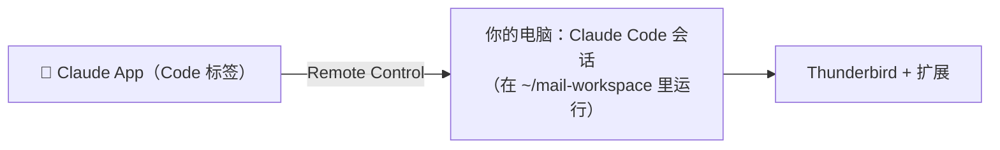

# 在手机上用

手机上的 Claude 默认在云端运行，碰不到你电脑上的 Thunderbird。**Remote Control** 解决这个问题：会话实际在你的电脑上运行，手机只是一个遥控界面，所以电脑上的 MCP 服务器、规则文件都能用。



## 前提

- Claude 的 Pro、Max、Team 或 Enterprise 订阅（Team / Enterprise 需要管理员先开启 Remote Control）
- 电脑开着、联网，Thunderbird 开着
- 已经运行过 `./scripts/create-mail-workspace.sh`，有了 `~/mail-workspace` 文件夹

## 方法一：Claude Desktop（作者用的方式）

1. 在 Claude Desktop 的 **Code** 标签里新建一个本地会话，文件夹选 `~/mail-workspace`
2. 在输入框里输入 `/remote-control`（或 `/rc`），这个会话就能在手机上看到了
3. 想让以后的每个会话都自动连上：**设置 → Claude Code → Connect new sessions to Remote Control**
4. 手机上打开 Claude App → 底部的 **Code** → 找到带电脑图标、绿点在线的会话

## 方法二：终端（服务器模式，适合从手机随时开新会话）

```bash
cd ~/mail-workspace
claude remote-control --name "邮件助手"
```

这个进程会一直挂着，等手机来连接。手机上可以随时在这个文件夹里开新会话。按空格会显示二维码，手机扫码直接打开。第一次运行会问是否信任这个文件夹，输入 `y`。

## 用起来

在手机上对这个会话说"看看这周的邮件"就行。`CLAUDE.md` 里的规则会自动生效：逐封读全文、整理活动、回复只存草稿。草稿会同步到邮箱服务器，你在手机的邮件 App（Outlook、Gmail 等）里检查后自己发送。

## 常见问题

**手机上说 thunderbird 那条通道没连上**
- 这个会话可能是在云端运行的，不是 Remote Control 会话。在手机的会话列表里，Remote Control 会话有电脑图标。
- 会话的文件夹不是 `~/mail-workspace`，没有加载 `.mcp.json`。
- 第一次在这个文件夹里用时，Claude Code 会问是否启用 `.mcp.json` 里的服务器。`create-mail-workspace.sh` 生成的 `.claude/settings.json` 已经写了 `enabledMcpjsonServers`，一般不会再问；如果你改过这个文件，检查它还在不在。
- 电脑上的 Thunderbird 没开。

**电脑睡眠了怎么办？** 会话会在电脑醒来后自动重连。要一直可用，见[常开部署](server.md)。

**会话太多很乱？** 方法二的服务器模式下，每次从手机新开一个会话即可，旧会话可以在 App 里归档。

官方文档：[Remote Control](https://code.claude.com/docs/en/remote-control)
